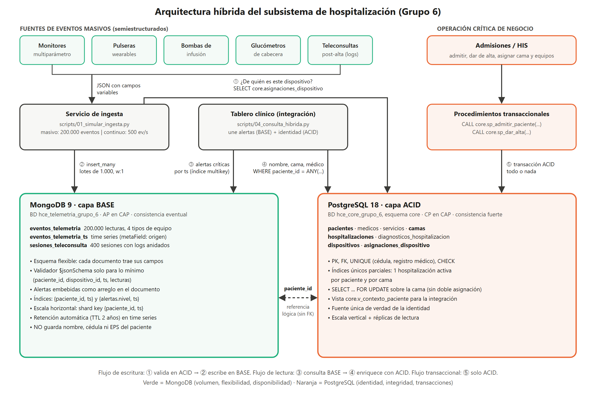

# Ecosistema híbrido PostgreSQL (ACID) + MongoDB (BASE) – Subsistema de hospitalización

**Grupo 6 · Bases de Datos II (G101) · Institución Universitaria Pascual Bravo**

Arquitectura híbrida para la historia clínica de hospitalización:

- **PostgreSQL 18 (capa ACID, BD `hce_core_grupo_6`)**: identidad del paciente, médicos, servicios, camas, hospitalizaciones, diagnósticos y la asignación *dispositivo → paciente*. Todo lo que no puede quedar "eventualmente" correcto.
- **MongoDB 9 (capa BASE, BD `hce_telemetria_grupo_6`)**: 200.000 eventos de telemetría (monitores, pulseras, bombas de infusión, glucómetros) con campos variables y alertas embebidas, la misma telemetría en una colección *time series* y 400 sesiones de teleconsulta.

Las dos capas se unen por `paciente_id`, `hospitalizacion_id` y `dispositivo_id` (referencia lógica, sin FK entre motores).



## Estructura

| Carpeta | Contenido |
|---|---|
| `sql/` | Scripts PostgreSQL: creación de BD, esquema ACID, datos maestros, demostración de transacciones, tablas comparativas y consultas comparativas |
| `nosql/` | Scripts mongosh: colecciones con validación `$jsonSchema` y *time series*, documentos de ejemplo, consultas comparativas y pipeline de agregación |
| `scripts/` | Python: generador de eventos (`comun.py`), simulador de ingesta, benchmark comparativo, gráficas y consulta híbrida |
| `datos/` | Muestras JSON de los documentos de telemetría y teleconsulta |
| `resultados/` | Métricas medidas (`metricas.json`, `metricas_resumen.csv`), planes de ejecución (`explain_*`) y salidas de consola |
| `capturas/` | Gráficas de métricas y capturas de ejecución |
| `docs/` | Diagrama de arquitectura (PNG y SVG) |
| `Grupo6_Ecosistemas_Hibridos.pdf` | Informe técnico |

## Requisitos

- PostgreSQL 18 (usuario `postgres` en `localhost`) y `psql` en el PATH
- MongoDB 6.3 o superior (probado con 9.0) en `localhost:27017` y `mongosh`
- Python 3.11+ → `py -m pip install -r requirements.txt`

Las conexiones se pueden cambiar con las variables de entorno `PG_DSN` y `MONGO_URI` (ver `scripts/comun.py`).

## Cómo ejecutar (desde esta carpeta)

```bash
# 1. Capa ACID
psql -U postgres -h localhost -f sql/01_crear_base_datos.sql
psql -U postgres -h localhost -d hce_core_grupo_6 -f sql/02_esquema_acid.sql
psql -U postgres -h localhost -d hce_core_grupo_6 -f sql/03_datos_maestros.sql
psql -U postgres -h localhost -d hce_core_grupo_6 -f sql/04_transacciones_acid.sql   # los ERROR de los casos 2-4 son esperados

# 2. Capa BASE + ingesta simulada
mongosh --file nosql/01_crear_colecciones.js
py scripts/01_simular_ingesta.py masivo --n 200000
py scripts/01_simular_ingesta.py continuo --segundos 30 --tasa 500   # flujo "en vivo"

# 3. Comparación (recarga los mismos eventos en ambos motores y mide)
py scripts/02_benchmark_comparativo.py
py scripts/03_graficas.py

# 4. Consultas para revisar a mano
py scripts/04_consulta_hibrida.py
mongosh --file nosql/02_documentos_ejemplo.js
mongosh --file nosql/03_consultas_comparativas.js
psql -U postgres -h localhost -d hce_core_grupo_6 -f sql/06_consultas_comparativas.sql
```

## Resultados principales (200.000 eventos, mismo equipo)

| Operación | MongoDB | PostgreSQL |
|---|---|---|
| O1 Ingesta masiva | **64.703 ev/s** (time series 34.651) | 10.663 ev/s (COPY 18.858, JSONB 12.357) |
| O2 Consulta puntual (con índice) | 5,4 ms | 5,2 ms |
| O3 Agregación por paciente | 219 ms (time series 135) | **70 ms** (JSONB 289) |
| O4 Alertas críticas + identidad | **1,7 ms** (híbrida Mongo + PG) | 9,2 ms (3 JOIN) |
| O5 Sensor nuevo | 0 DDL, 22 ms | 1 `ALTER TABLE`, 112 ms |
| O6 Admisión todo-o-nada | No disponible en standalone | **OK, 1,3 ms** |
| O7 Paciente inexistente | Aceptado | **Rechazado (FK)** |
| O8 Disco (datos + índices) | 21,1 MB (time series **4,1 MB**) | 41,5 MB (JSONB 102,7 MB) |

Conclusión: MongoDB domina la ingesta, la flexibilidad y el almacenamiento de eventos; PostgreSQL domina la integridad, las transacciones y la agregación sobre columnas tipadas. Por eso cada dato vive en el motor que mejor lo protege o lo escala. El análisis completo está en el informe PDF.

## Uso de IA

Esta documentación, los comentarios de los scripts y buena parte del código se generaron con apoyo de **Claude (Anthropic) mediante Claude Code**, La IA (un agente especializado en bases de datos) diseñó, programó y ejecutó las pruebas a partir de los prompts del estudiante; el estudiante guió el proceso y revisó el informe y los scripts. Los prompts, los errores depurados y el aporte de la IA están documentados en la sección 8 del informe. Todos los datos son sintéticos.
